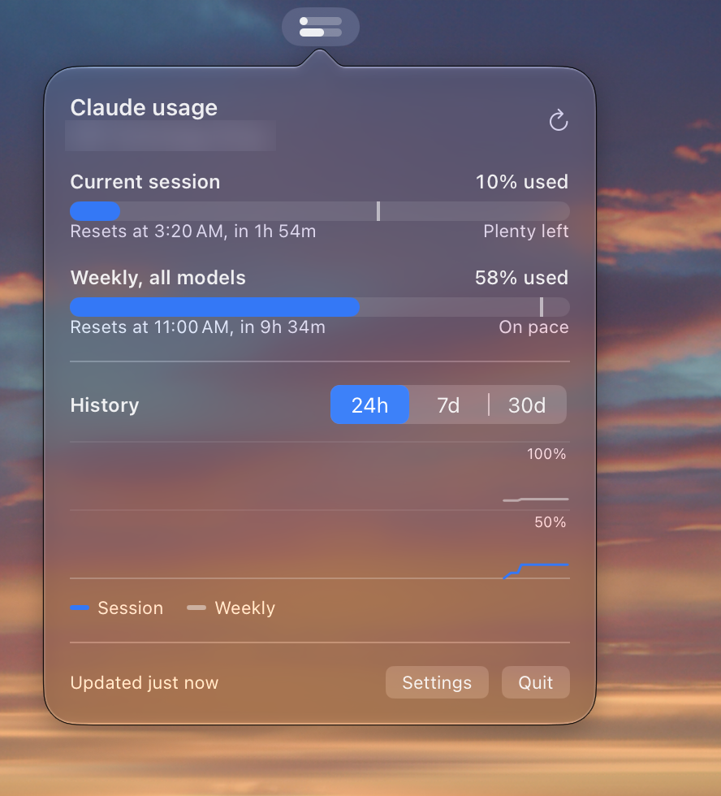
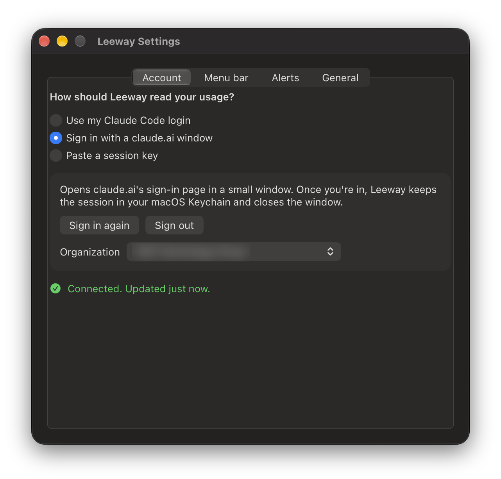
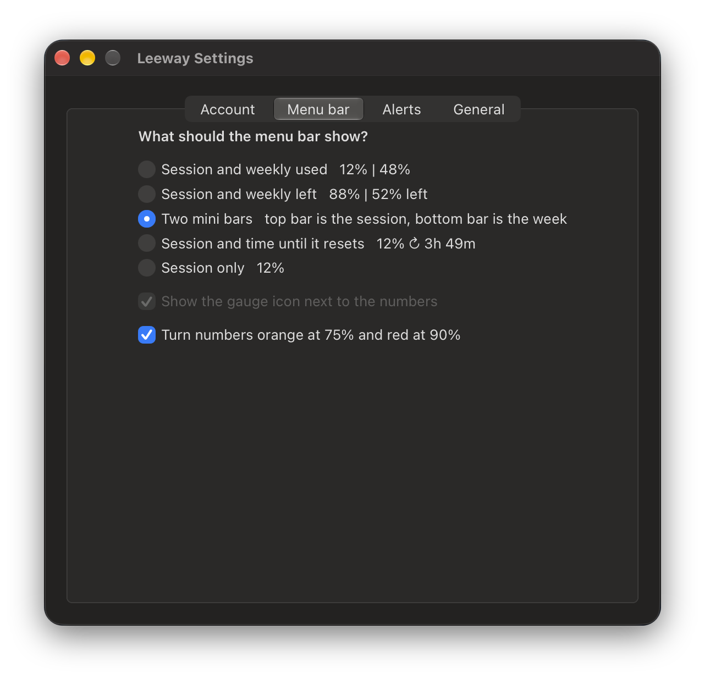
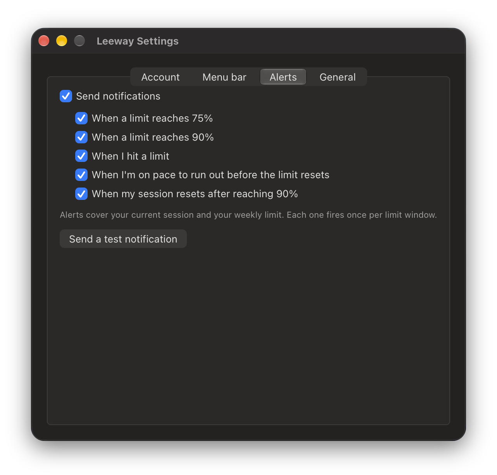
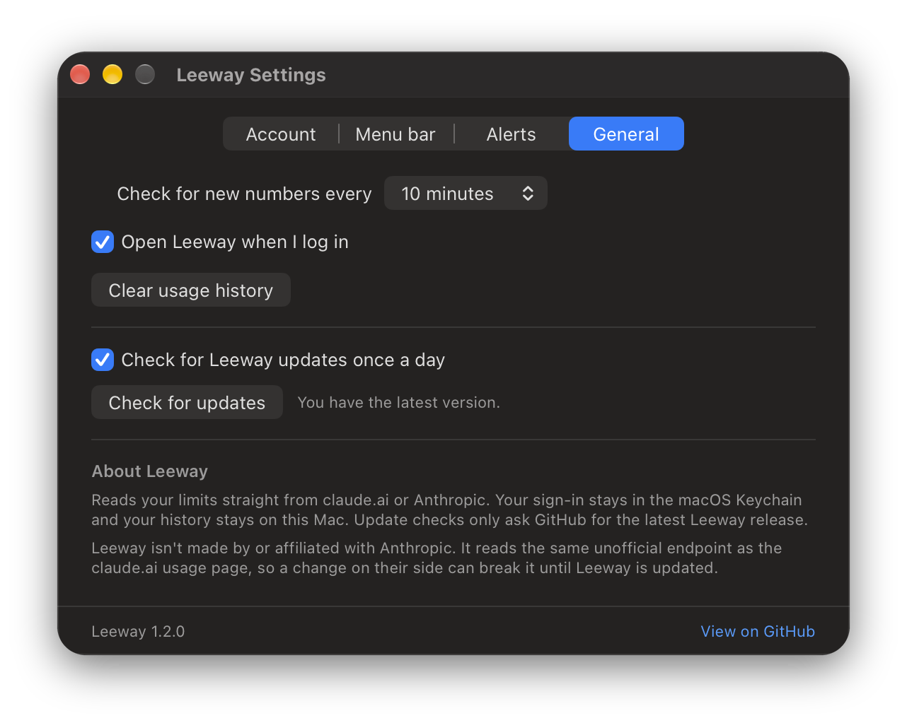
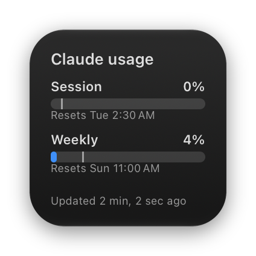
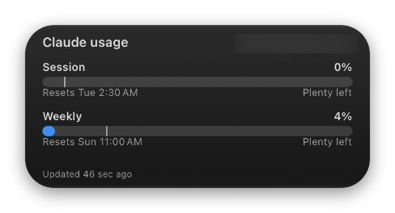

# Leeway

Your Claude usage limits in the Mac menu bar, so you don't have to open claude.ai Settings > Usage to see how much you have left.

Leeway shows the same numbers as that page: the current 5-hour session and the weekly limit, each with its reset time. It also tells you when you're on pace to run out before a limit resets.

<p align="center">
  
</p>

Runs on macOS 11 Big Sur and newer, on both Apple Silicon and Intel Macs (one universal app).

## What you get

- **Five menu bar styles.** `12% | 48%` used, `88% | 52% left`, two mini bars, `12% ↻ 3h 49m` (session plus time until it resets), or the session alone. Optional gauge icon. Numbers turn orange at 75% and red at 90%.
- **Three ways to connect.** Reuse the Claude Code login already on your Mac, sign in to claude.ai in a small built-in window, or paste a `sessionKey` cookie.
- **Pace tick.** Each bar has a thin tick showing how much of the window has passed. Fill to the left of the tick means you're under pace. If you're on track to run out early, the popover says when, for example "Runs out around Thu 3:10 PM".
- **Alerts.** At 75%, at 90%, when you hit a limit, when you're on pace to run out, and when your session resets after you hit 90%. Each fires once per limit window.
- **History chart.** Session and weekly usage over the last 24 hours, 7 days or 30 days.
- **Open at login**, refresh every 1 to 30 minutes, plus an extra refresh when your Mac wakes up. Right-click the menu bar item for Refresh, Settings and Quit.
- **Widget** (macOS 14 Sonoma and later). A small or medium widget for the desktop or Notification Center, with both bars, pace ticks and reset times. Right-click the desktop, choose Edit Widgets and search for Leeway. You can hide the menu bar item and use only the widget.
- **Updates from inside the app.** Leeway checks GitHub once a day. When a new release is out, click Update now in the popover and it installs itself and reopens. You can also right-click the menu bar item and choose Check for Updates.
- **Times match your Mac.** Reset times follow the 12-hour or 24-hour setting in System Settings > General > Date & Time.

## Screenshots

| Account | Menu bar |
| :---: | :---: |
|  |  |
| **Alerts** | **General** |
|  |  |

**Widget** (small and medium)

<p align="center">
  
  
</p>

## Install

### Download

Get `Leeway-x.y.z.zip` from the [latest release](https://github.com/cutthroat361/Leeway/releases/latest), unzip it and move Leeway to Applications. It runs on Apple Silicon and Intel Macs.

The download isn't signed with an Apple Developer ID yet, so macOS blocks it the first time. Open it once, then go to System Settings > Privacy & Security and click Open Anyway. Later versions install from inside Leeway, without this step.

### Build it yourself

You need Apple's command line tools. If you use Homebrew you already have them. If not, run `xcode-select --install` once.

In Terminal, from the Leeway folder:

```bash
bash build.sh --install
```

That compiles the app, copies it to `/Applications`, and opens it. Look for the gauge in your menu bar.

Apple's newest command line tools (macOS 27 and later) can no longer build for Intel Macs, so on those the build is for Apple Silicon only. The downloads on the GitHub releases page are always universal.

## Connect your account

The first time it opens, Leeway picks a method for you: your Claude Code login if it finds one, otherwise the sign-in window. Change it any time in Settings > Account.

**Use my Claude Code login.** If you've signed in to Claude Code on this Mac, there's nothing to do. Leeway reads the login Claude Code saved and never changes it, so Claude Code keeps working normally. If the login expires, run `claude` once and it renews.

**Sign in with a claude.ai window.** Click Sign in to Claude and sign in the way you normally do. The window closes by itself once you're in. If Google sign-in is blocked inside the window, choose Continue with email and type the code from the email.

**Paste a session key.** For people who prefer to copy it themselves:

1. Open claude.ai in your browser and sign in.
2. Open the developer tools with Cmd+Option+I. In Safari, first turn on Settings > Advanced > Show features for web developers.
3. Go to Application (Chrome, Edge) or Storage (Safari, Firefox), then Cookies, then `https://claude.ai`.
4. Copy the value of `sessionKey` and paste it into Settings > Account.

If your account belongs to more than one organization (for example a Team org and a personal one), Leeway uses the first one that has usage limits. You can switch in Settings > Account.

## Sharing it with other people

`build.sh` signs the app for your own Mac only. That's fine for you and for anyone who builds it themselves. If you send the built app to someone else, macOS will block it the first time. They can still open it from System Settings > Privacy & Security > Open Anyway, but it's not a smooth experience.

For a clean install on anyone's Mac, sign and notarize it with an Apple Developer ID (the Apple Developer Program costs $99 a year):

```bash
# one time: save your notarization login in the Keychain
xcrun notarytool store-credentials leeway --apple-id you@example.com --team-id TEAMID

# each release
VERSION=1.0.0 \
SIGN_IDENTITY="Developer ID Application: Your Name (TEAMID)" \
NOTARY_PROFILE=leeway \
bash build.sh
```

The zip in `build/` is then ready to put on a website or a GitHub release.

### GitHub releases

`.github/workflows/release.yml` builds the universal app on GitHub's Macs. Publish a release with a new tag such as `v1.3.1` and the zip is attached to it.

Releases are signed and notarized automatically once these five secrets are saved under the repository's Settings > Secrets and variables > Actions. Without them, releases are unsigned.

| Secret | What it is |
| --- | --- |
| `MACOS_CERTIFICATE` | Your Developer ID Application certificate, exported from Keychain Access as a `.p12` file and base64-encoded: `base64 -i Leeway.p12 \| pbcopy` |
| `MACOS_CERTIFICATE_PASSWORD` | The password you chose when exporting the `.p12` |
| `APPLE_ID` | The email of your Apple developer account |
| `APPLE_TEAM_ID` | Your 10-character Team ID, shown under Membership at developer.apple.com/account |
| `APPLE_APP_PASSWORD` | An app-specific password made at account.apple.com > Sign-In and Security |

The certificate only lives in a temporary keychain during the build and is deleted afterwards. Once people have a signed copy, Leeway only installs updates signed by the same developer team.

## Privacy

- Your claude.ai session is stored in the macOS Keychain. The Claude Code login is read from where Claude Code keeps it and is never copied or changed.
- Usage requests go only to `claude.ai` and `api.anthropic.com`.
- Once a day Leeway asks GitHub (`api.github.com`) for the latest Leeway release. Nothing about you or your usage is sent. Turn it off in Settings > General.
- History stays on your Mac in `~/Library/Application Support/Leeway/history.json`. Clear it in Settings > General.
- The widget reads a summary Leeway saves next to it (`widget.json`). The widget runs in a sandbox that can read only that folder.
- No analytics and no tracking.

## Troubleshooting

**"Your claude.ai sign-in has expired."** Open Settings > Account and sign in again, or paste a fresh session key.

**"Claude Code's login has expired."** Run `claude` in Terminal once, then click refresh in Leeway.

**macOS asks Leeway for permission to use the Keychain.** Click Always Allow. This can come back after an update or a rebuild, because each build has a new signature until Leeway is signed with a Developer ID.

**No notifications.** Open Settings > Alerts and click Send a test notification. Leeway tells you if notifications are off or banners are hidden. If it says the test was sent but no banner appeared, a Focus such as Do Not Disturb or Sleep is probably on.

**Launch at login doesn't stick.** Make sure Leeway is in `/Applications`, then turn the option off and on again.

**The numbers stopped updating after an Anthropic update.** Leeway reads an unofficial endpoint, the same one the claude.ai usage page uses. If its format changes, Leeway needs an update.

## Credits

Ideas borrowed from two open-source projects: [Claude Usage Tracker](https://github.com/hamed-elfayome/Claude-Usage-Tracker) by Hamed Elfayome (sign-in options, Keychain storage) and [Claude Usage Bar](https://github.com/Blimp-Labs/claude-usage-bar) by Blimp Labs (mini bars, history chart). Leeway's code is written from scratch.

## Disclaimer

Leeway isn't made by, affiliated with, or endorsed by Anthropic. Claude is a trademark of Anthropic PBC.

MIT License, copyright (c) 2026 EKorol. See [LICENSE](LICENSE).
